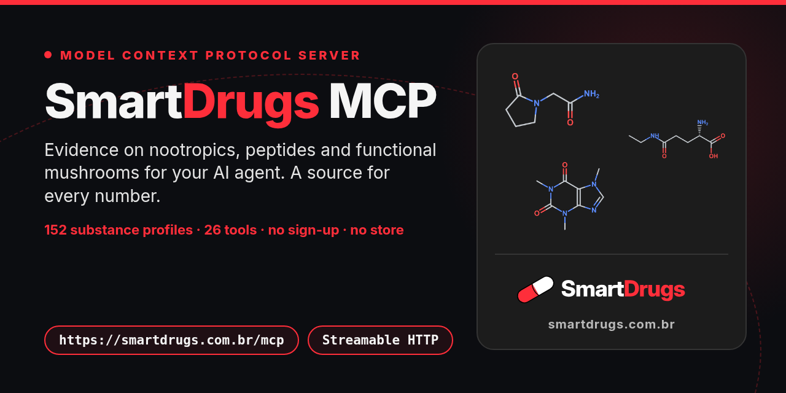

<p align="center">
  <a href="https://smartdrugs.com.br/"></a>
</p>

<p align="center">
  <a href="https://registry.modelcontextprotocol.io/v0/servers?search=br.com.smartdrugs"></a>
  
  
  
  
  <a href="LICENSE"></a>
</p>

<p align="center">
  <a href="https://kiro.dev/launch/mcp/add?name=SmartDrugs&config=%7B%22url%22%3A%22https%3A%2F%2Fsmartdrugs.com.br%2Fmcp%22%2C%22disabled%22%3Afalse%2C%22autoApprove%22%3A%5B%5D%7D"></a>
</p>

<p align="center">
  <a href="#install">Install</a> ·
  <a href="#tools">Tools</a> ·
  <a href="#example-prompts">Example prompts</a> ·
  <a href="#how-the-evidence-works">Evidence</a> ·
  <a href="#safety">Safety</a> ·
  <a href="#português">Português</a>
</p>

# SmartDrugs MCP

**SmartDrugs** is an independent, evidence-based information platform on nootropics. It does not sell products and has no store; some links are affiliate links, and they are always labeled. It covers nootropics, peptides, functional mushrooms, adaptogens and cannabinoids, every claim on a profile points to its source, and it never tells anyone what to take.

Create a free SmartDrugs account and join the community. Enter the N=1 game with your Google account (18 or older), in one click, at https://smartdrugs.com.br/n1/ . SmartDrugs does not create or store a password.

This MCP server puts the SmartDrugs catalog inside your AI agent: 152 substance profiles with mechanism, what the studies show and at which level of evidence, side effects, drug interactions with severity, the doses used in the studies, regulatory status in Brazil, and the sources behind each number.

| | |
| --- | --- |
| **Endpoint** | `https://smartdrugs.com.br/mcp` |
| **Transport** | Streamable HTTP (JSON responses, no SSE stream) |
| **Authentication** | None to read. Community actions use a per-conversation key the person approves on the site |
| **Registry ID** | `br.com.smartdrugs/mcp` |
| **Server card** | [`/.well-known/mcp/server-card.json`](https://smartdrugs.com.br/.well-known/mcp/server-card.json) |
| **Content language** | Brazilian Portuguese (pt-BR). Your agent can answer in any language |

There is nothing to download. This repository holds the public documentation and the install manifests for the hosted server.

## Install

Add the remote URL to your client. No account, API key or OAuth is needed to read the catalog.

If an agent is installing this for you, point it at [llms-install.md](llms-install.md).

<details open>
<summary><strong>Claude</strong></summary>

**Claude, Claude Desktop and Cowork.** Add a custom connector with this URL:

```text
https://smartdrugs.com.br/mcp
```

Anthropic's steps are in [Get started with custom connectors using remote MCP](https://support.claude.com/en/articles/11175166-get-started-with-custom-connectors-using-remote-mcp).

**Claude Code**

```bash
claude mcp add --transport http smartdrugs https://smartdrugs.com.br/mcp
```

This repository is also a Claude Code plugin: [`.claude-plugin/plugin.json`](.claude-plugin/plugin.json).

</details>

<details>
<summary><strong>ChatGPT</strong></summary>

Add a custom MCP server with the same URL and choose no authentication:

```text
https://smartdrugs.com.br/mcp
```

OpenAI's guide, [Developer mode and MCP apps in ChatGPT](https://help.openai.com/en/articles/12584461-developer-mode-and-mcp-apps-in-chatgpt), has the current screens and plan requirements. The server publishes UI templates for the profile, interaction check, 24 hour curve and stack tools, so clients that render MCP Apps can show them as cards.

</details>

<details>
<summary><strong>Gemini CLI</strong></summary>

This repository is a Gemini CLI extension:

```bash
gemini extensions install https://github.com/smartdrugs-org/mcp
```

The manifest is [`gemini-extension.json`](gemini-extension.json) and the context file is [`GEMINI.md`](GEMINI.md).

</details>

<details>
<summary><strong>Cursor</strong></summary>

Add this to `~/.cursor/mcp.json` or to the project's `.cursor/mcp.json`:

```json
{
  "mcpServers": {
    "smartdrugs": {
      "url": "https://smartdrugs.com.br/mcp"
    }
  }
}
```

The Cursor plugin files are [`.cursor-plugin/plugin.json`](.cursor-plugin/plugin.json) and [`.mcp.json`](.mcp.json).

</details>

<details>
<summary><strong>VS Code and GitHub Copilot</strong></summary>

```bash
code --add-mcp '{"name":"smartdrugs","type":"http","url":"https://smartdrugs.com.br/mcp"}'
```

[`plugin.json`](plugin.json) and [`mcp.json`](mcp.json) are the Agent Plugins manifests for GitHub Copilot, VS Code agent plugins and Kiro.

</details>

<details>
<summary><strong>Kiro</strong></summary>

One-click install with the official Add to Kiro badge:

[](https://kiro.dev/launch/mcp/add?name=SmartDrugs&config=%7B%22url%22%3A%22https%3A%2F%2Fsmartdrugs.com.br%2Fmcp%22%2C%22disabled%22%3Afalse%2C%22autoApprove%22%3A%5B%5D%7D)

The Agent Plugins manifests are [`plugin.json`](plugin.json) and [`mcp.json`](mcp.json).

</details>

<details>
<summary><strong>Windsurf, LM Studio, Cline and other clients</strong></summary>

Any client that supports remote MCP over Streamable HTTP can use the same block:

```json
{
  "mcpServers": {
    "smartdrugs": {
      "url": "https://smartdrugs.com.br/mcp"
    }
  }
}
```

Clients that only speak stdio can go through a bridge such as [`mcp-remote`](https://www.npmjs.com/package/mcp-remote):

```json
{
  "mcpServers": {
    "smartdrugs": {
      "command": "npx",
      "args": ["-y", "mcp-remote", "https://smartdrugs.com.br/mcp"]
    }
  }
}
```

</details>

<details>
<summary><strong>Grok</strong></summary>

The plugin manifest is [`.grok-plugin/plugin.json`](.grok-plugin/plugin.json). It points to the same remote URL through [`.mcp.json`](.mcp.json).

</details>

### Plugin manifests

| Client | Files |
| --- | --- |
| MCP Registry | [`server.json`](server.json) (`br.com.smartdrugs/mcp`) |
| Claude Code | [`.claude-plugin/plugin.json`](.claude-plugin/plugin.json), [`.mcp.json`](.mcp.json) |
| Cursor | [`.cursor-plugin/plugin.json`](.cursor-plugin/plugin.json), [`.mcp.json`](.mcp.json) |
| GitHub Copilot, VS Code agent plugins, Kiro | [`plugin.json`](plugin.json), [`mcp.json`](mcp.json) |
| Gemini CLI | [`gemini-extension.json`](gemini-extension.json), [`GEMINI.md`](GEMINI.md) |
| Grok | [`.grok-plugin/plugin.json`](.grok-plugin/plugin.json) |
| Agent skill | [`skills/smartdrugs-evidence/SKILL.md`](skills/smartdrugs-evidence/SKILL.md) |

## Tools

These are the 26 tools the server returns from `tools/list` (server version 1.5.0). Tool names and outputs are in Portuguese. 21 tools only read public data. 5 tools act in the SmartDrugs community on behalf of a person, and only after that person approves the connection on the site.

### Safety

| Tool | What it does |
| --- | --- |
| `contatos_de_emergencia` | Brazilian emergency numbers (SAMU 192, Disque-Intoxicação 0800 722 6001, CVV 188, Bombeiros 193, Polícia 190, Disque Saúde 136) and when to call each one. The server tells agents to use it first when someone describes feeling unwell, a suspected poisoning, severe symptoms or emotional distress. |

### Catalog and evidence

| Tool | What it does |
| --- | --- |
| `buscar_substancias` | Search profiles by name, nickname or topic, with filters by goal (focus, memory, sleep...) and type (nootropic, peptide, mushroom, adaptogen). |
| `obter_ficha` | Full profile: summary, mechanism, what studies show with evidence level, side effects, interactions with severity, study doses, regulatory status and sources, with the molecule drawing. Can return only selected sections. |
| `listar_objetivos` | The goals used to organize profiles, with how many profiles each one has. |
| `comparar_substancias` | Compare 2 to 4 substances side by side: type, goals, evidence level, main studied benefits, studied range, half life, effects, interactions and status in Brazil. |
| `listar_artigos` | Published articles, newest first, with an optional tag filter. |
| `obter_artigo` | Full article in Markdown: study summary, relevance score with its criteria, links to catalog profiles and sources. |

### Interactions, doses and timing

| Tool | What it does |
| --- | --- |
| `verificar_interacoes` | Cross substances with each other and with common medicines (generic name, brand or class, such as sertraline or anticoagulants). Returns the interactions the profiles publish, with severity, explanation and sources, and flags stacked stimulants or sedatives. No alert does not mean a combination is safe. |
| `faixa_de_dose` | Doses used in the studies, grouped by how they were measured, with each study's population and source, the highest dose tested, reported toxicity, adverse effects with dose thresholds, half life and time to peak. Not a recommendation. |
| `curva_24h` | Relative blood concentration over 24 hours for up to 8 substances, each taken in the morning (8 am), afternoon (2 pm) or night (9 pm), from the half life and time to peak published in the profiles. Shows what is left at 11 pm. |
| `avaliar_stack` | Check a combination of up to 8 substances, each with a dose and a time of day (morning, afternoon or night), using the same engine as the site's NeuroAtlas: dose versus studied range, adverse effect thresholds reached, body systems involved, interactions, late stimulants, and evidence, safety, synergy and simplicity notes. Not a recommendation. |

### Community (read only)

| Tool | What it does |
| --- | --- |
| `listar_stacks` | Public stacks built by members in NeuroAtlas, by points or by the monthly ranking. Substances controlled in Brazil (lists of Portaria SVS/MS 344/1998, such as amphetamine, methylphenidate and modafinil) cannot be added to stacks, and stacks that contain them are not public. |
| `obter_stack` | One public stack by id, with author, items and its current evaluation against the profiles. |
| `resumo_relatos` | Summary of published user reports for a substance. Counts appear only from 5 reports and distributions from 20. Personal experience, not scientific evidence. |
| `listar_relatos` | Published reports (each one reviewed by the team before it appears), by block: what was used, how, what was noticed, adverse effects, precautions. |
| `ler_comentarios` | Comments, questions and answers on a profile, article or other page. |
| `ranking_membros` | Public member ranking for the month and all time. |
| `listar_selos` | The badges members can earn and the rule for each. |
| `perfil_membro` | A member's public profile by @nick. |

### Community account (acts for a person, needs their approval)

| Tool | What it does |
| --- | --- |
| `entrar_na_comunidade` | Returns a link and a code. The person opens the link, signs in with Google, checks the code and approves. SmartDrugs never creates or stores a password. The connection lasts 7 days. |
| `minha_conexao` | Whether the connection was approved, whose it is and when it expires. |
| `enviar_relato` | Send the person's report for team review. The agent must show the final text and get two confirmations in the conversation: the text, and a statement that it is their own experience, that they are 18 or older and accept the terms. |
| `meus_relatos` | The person's reports and the status of each one. |
| `publicar_comentario` | Post a comment, question or answer as the person, after they approve the final text. |
| `reagir_relato` | Mark a report as "useful" or "similar to me", only when the person asks. |
| `sair_da_comunidade` | End the connection. The key stops working at once. |

### Resources and prompts

**Resources.** 152 profiles as `smartdrugs://ficha/{slug}` (Markdown), plus `smartdrugs://objetivos` and `smartdrugs://classes-interacao` (JSON). Templates: `smartdrugs://ficha/{slug}`, `smartdrugs://molecula/{slug}` (2D molecule, PNG), `smartdrugs://artigo/{slug}` and `smartdrugs://stack/{id}`. UI templates: `ui://smartdrugs/ficha.html`, `interacoes.html`, `curva.html` and `stack.html`.

**Prompts.** `avaliar_meu_stack`, `comparar_substancias`, `checar_remedio`, `entender_substancia` and `contar_minha_experiencia`.

## Example prompts

- What do the studies say about L-theanine with caffeine for focus? Cite the profile.
- I take sertraline. Does any of these interact with it: 5-HTP, ashwagandha, rhodiola?
- Compare lion's mane, bacopa and alpha-GPC for memory.
- Which doses of creatine were used in the studies, and in which populations?
- If I have caffeine in the afternoon, how much is still in my blood at 11 pm?
- Check this stack against the studies: caffeine 100 mg and L-theanine 200 mg in the morning, magnesium L-threonate at night.
- What do community reports say about ashwagandha?
- Explique em português o que é o piracetam e qual a situação dele na Anvisa.

## How the evidence works

- Each profile lists its sources, and the tools return them with the data. Agents are asked to cite the profile URL.
- Evidence levels come from the studies on the profile, not from brands.
- Doses are **the doses used in studies**, grouped by how they were measured. They are not dosing advice.
- Interaction results only cover what the profiles publish. Not finding an alert does not mean a combination is safe.
- Community reports are personal experience. They are reviewed by the team, cannot contain a shop, price, coupon or contact, and are never presented as evidence.

## Safety

SmartDrugs content is educational. It does not replace a doctor, it does not diagnose and it does not prescribe.

If you or someone near you is unwell after using a substance, may have been poisoned, or is thinking about self harm, in Brazil call **SAMU 192**, **Disque-Intoxicação 0800 722 6001** or **CVV 188**. Outside Brazil, call your local emergency number.

## Privacy and security

- Privacy policy: https://smartdrugs.com.br/privacidade/
- Reading needs no account and sends no personal data beyond what you type in the request.
- Community tools work only after the person approves the connection on smartdrugs.com.br with Google. The connection key (`sdm_...`) belongs to that conversation, lasts 7 days and can be revoked at any time.
- Every write tool requires the person to approve the final text in the conversation first.
- Report security issues privately, see [SECURITY.md](SECURITY.md).

## Other machine readable access

| What | Where |
| --- | --- |
| Developer docs | https://smartdrugs.com.br/desenvolvedores/ |
| JSON API and OpenAPI 3.1 | https://smartdrugs.com.br/api/v1/openapi.json |
| A2A agent | https://smartdrugs.com.br/a2a (card at `/.well-known/agent-card.json`) |
| Markdown of any page | add `index.md` to the URL or send `Accept: text/markdown` |
| llms.txt | https://smartdrugs.com.br/llms.txt and `/llms-full.txt` |
| RSS | https://smartdrugs.com.br/feed.xml |

Quick test from a terminal: [`examples/`](examples/).

```bash
curl -s https://smartdrugs.com.br/mcp \
  -H 'Content-Type: application/json' \
  -H 'Accept: application/json, text/event-stream' \
  -d '{"jsonrpc":"2.0","id":1,"method":"tools/list","params":{}}'
```

## Português

**SmartDrugs** é uma plataforma independente de informação sobre nootrópicos, baseada em evidência. Não vende produtos nem tem loja; alguns links são de afiliado e vêm identificados. Nunca diz a ninguém o que tomar.

Crie sua conta gratuita na SmartDrugs e entre na comunidade. O jogo N=1 abre com a sua conta Google (maiores de 18 anos), em um clique, em https://smartdrugs.com.br/n1/ . A SmartDrugs não cria nem guarda senha.

O **SmartDrugs MCP** coloca as fichas do SmartDrugs dentro do seu agente de IA: 152 fichas de nootrópicos, peptídeos, cogumelos funcionais, adaptógenos e canabinoides, com mecanismo, o que os estudos mostram e com qual nível de evidência, efeitos colaterais, interações com remédios, doses usadas nos estudos, situação na Anvisa e a fonte de cada número.

**Endereço:** `https://smartdrugs.com.br/mcp` (Streamable HTTP, sem cadastro para leitura).

**Como instalar.** No Claude, adicione um conector personalizado com o endereço acima. No Claude Code:

```bash
claude mcp add --transport http smartdrugs https://smartdrugs.com.br/mcp
```

No Cursor, no Windsurf e em outros clientes, use:

```json
{ "mcpServers": { "smartdrugs": { "url": "https://smartdrugs.com.br/mcp" } } }
```

**O que dá para perguntar**

- O que os estudos dizem sobre L-teanina com cafeína para foco?
- Eu tomo sertralina. Alguma destas substâncias interage com ela: 5-HTP, ashwagandha, rhodiola?
- Compare juba-de-leão, bacopa e alfa-GPC para memória.
- Quais doses de creatina foram usadas nos estudos?
- Se eu tomar cafeína à tarde, quanto ainda resta no sangue às 23h?
- O que dizem os relatos da comunidade sobre ashwagandha?

**Comunidade.** Quem já usou uma substância pode deixar um relato pela própria conversa: o agente chama `entrar_na_comunidade`, você autoriza no site com a conta Google (a SmartDrugs não cria nem guarda senha), revisa o texto final e confirma. Todo relato passa pela equipe antes de aparecer. A leitura é pública e sem cadastro; com o login do Google, a pessoa também participa da comunidade (5 ferramentas), sempre com confirmação no chat. A conexão vale 7 dias.

**Aviso.** Conteúdo educacional. Não substitui orientação médica, não faz diagnóstico nem prescrição. Doses das fichas são doses usadas em estudos, não recomendação. Em caso de mal-estar, suspeita de intoxicação ou sofrimento emocional: **SAMU 192**, **Disque-Intoxicação 0800 722 6001**, **CVV 188**.

## Links

- Website: https://smartdrugs.com.br/
- N=1 game: https://smartdrugs.com.br/n1/
- Developer docs: https://smartdrugs.com.br/desenvolvedores/
- Medical disclaimer: https://smartdrugs.com.br/aviso-medico/
- Terms: https://smartdrugs.com.br/termos/
- Privacy policy: https://smartdrugs.com.br/privacidade/
- About: https://smartdrugs.com.br/sobre/
- Contact: [contato@smartdrugs.com.br](mailto:contato@smartdrugs.com.br)
- Issues: https://github.com/smartdrugs-org/mcp/issues

## License

The manifests and documentation in this repository are released under the [MIT License](LICENSE). The SmartDrugs name and logo are covered by [TRADEMARKS.md](TRADEMARKS.md). The hosted server and the content it returns are run by SmartDrugs and are not distributed here.
